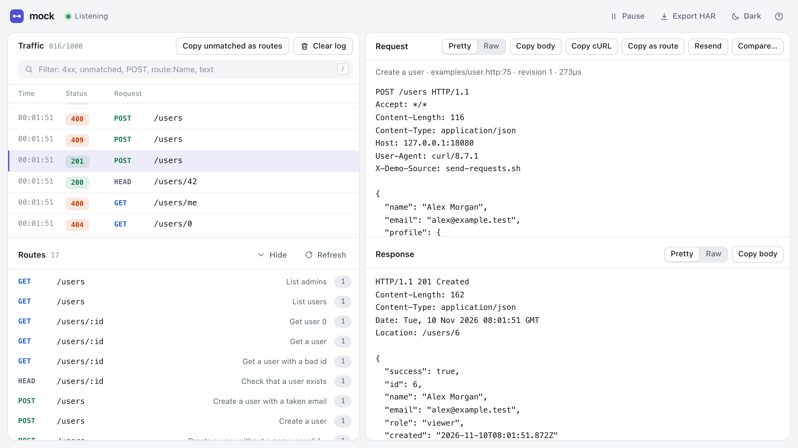

# mock

[](https://github.com/sspencer/mock/actions/workflows/go.yml)
[](https://github.com/sspencer/mock/releases/latest)
[](LICENSE)

`mock` turns REST Client-style `.http` files into a local HTTP server with hot
reload and a request-log UI. It is a single binary for the gap between
hand-written test doubles and a real backend — not a replacement for WireMock,
Prism, or Mockoon, and not the Go unit-test mocking libraries (gomock, mockery).

## Install

```sh
go install github.com/sspencer/mock@latest
```

This needs Go 1.26 or newer. Binaries for Linux, macOS and Windows are on the
[Releases](https://github.com/sspencer/mock/releases) page, and
`brew install --cask sspencer/tap/mock` and `ghcr.io/sspencer/mock` work too.
See [Install](docs/install.md) for those and for building from source.

## Your first mock

Save this as `hello.http`. Each `###` section is one route: a request line,
the response headers, a blank line, then the response body.

```http
### Get a user
GET /users/:id
Content-Type: application/json

{"id": {{$id}}, "name": "{{$name}}", "email": "{{$email}}"}

### [201] Create a user
POST /users
Content-Type: application/json

{"id": "{{$uuid}}", "name": "{{$json.name}}"}
```

Serve it:

```sh
mock hello.http
```

```text
starting mock HTTP server on 127.0.0.1:8080
admin UI at http://127.0.0.1:8081/
watching request files for changes
Available mock methods:
  GET     /users/:id                     Get a user
  POST    /users                         Create a user
```

Then call it:

```sh
curl localhost:8080/users/7
# {"id": 7, "name": "Malcolm Kemmer", "email": "weber@rck.com"}

curl -X POST -d '{"name":"Ann"}' localhost:8080/users
# 201 {"id": "5db51105-8ea4-4501-a74b-40c3fd0b3c1d", "name": "Ann"}
```

`{{$id}}` is the `:id` path parameter, `{{$name}}`, `{{$email}}` and
`{{$uuid}}` are generated on every response, and `{{$json.name}}` comes from
the request body. Edit and save the file and the routes reload; there is
nothing to restart.

`mock init` writes a longer, commented starter file if you would rather begin
from that. [Getting started](docs/getting-started.md) walks through it and the
examples in `examples/`, and the [example gallery](docs/examples.md) has
ready-made mocks for OAuth, pagination, uploads, webhooks and payments.

## The admin UI

Open [http://localhost:8081/](http://localhost:8081/) to watch requests arrive.

<picture>
  <source media="(prefers-color-scheme: dark)" srcset="./docs/web-dark.png">
  
</picture>

The left side lists live traffic and the loaded routes. Select a request to
see what was sent, which route answered and what it returned, or why no route
matched. From there you can filter the log, resend a request with edits,
compare two requests, copy one as a new route, edit a route's fixture data and
export a HAR file. See [Admin UI and API](docs/admin-ui.md).

## What else it does

- **Match on more than the path.** Choose a route by header, query, path
  parameter, cookie, JSON, form or XML body value, with exact, wildcard, regex
  and negated matchers. [Matching](docs/matching.md)
- **Generate data.** Faker values, dates, signed tokens, repeated lists,
  conditional blocks, fixture files (JSON, CSV or NDJSON, with lookup by key
  and paging), the echoed request, and seeds for repeatable output.
  [Placeholders](docs/placeholders.md)
- **Serve files.** Send a response body from a file, with range and
  conditional requests. [Request files](docs/request-files.md#external-response-bodies)
- **Misbehave on purpose.** Long-tail delays, throttled downloads, chunked
  streams, resets, hangs and garbage replies, rate limits per client, and
  faults you switch on at run time.
  [Delays, faults and callbacks](docs/responses.md)
- **Call back.** Send a webhook after a response.
  [Webhook callbacks](docs/responses.md#webhook-callbacks)
- **Work beside a real API.** Forward unmatched requests upstream, record them
  as routes, import a HAR file, and check your mocks for drift.
  [Working with real APIs](docs/real-apis.md)
- **Run in tests and CI.** Strict mode fails on unmatched requests and reports
  route coverage, `mock validate` lints request files, and the `mocktest`
  package starts a mock inside a Go test. [Testing](docs/testing.md)
- **Serve several ports at once** from one process.
  [Multiple ports](docs/matching.md#multiple-ports)
- **Reuse REST Client files** and their environments.
  [REST Client files](docs/request-files.md#rest-client-files)

## Documentation

| Page | What it covers |
|------|----------------|
| [Getting started](docs/getting-started.md) | `mock init`, the example APIs, and scripts that fill the admin UI |
| [Install](docs/install.md) | Go install, release binaries, building from source, Docker |
| [Command line](docs/cli.md) | Flags, JSON logs, reloading, directories, `mock validate` |
| [Request files](docs/request-files.md) | The `.http` dialect, `< file` bodies, variables, and every `@` directive |
| [Placeholders and generated data](docs/placeholders.md) | `{{$...}}` values, filters, fixtures, lists, seeds |
| [Matching, route order and ports](docs/matching.md) | Matchers, which route wins, multiple ports |
| [Delays, faults and callbacks](docs/responses.md) | Latency, streaming, faults, rate limits, compression, webhooks |
| [Working with real APIs](docs/real-apis.md) | `--upstream`, recording, `@proxy`, `mock check`, `mock import` |
| [Testing with mock](docs/testing.md) | Strict mode, route coverage, the `mocktest` Go package |
| [Recipes](docs/recipes.md) | GraphQL, content negotiation, per-test responses, readiness checks |
| [Admin UI and API](docs/admin-ui.md) | The UI, access token, redaction, admin endpoints, safety limits |

## Development

```sh
make verify   # format check, vet, Go tests and UI tests
```

See [CONTRIBUTING.md](CONTRIBUTING.md) for setup and pull-request notes.
Release history is in [CHANGELOG.md](CHANGELOG.md), and
[docs/ideas.md](docs/ideas.md) collects ideas for
future work.
