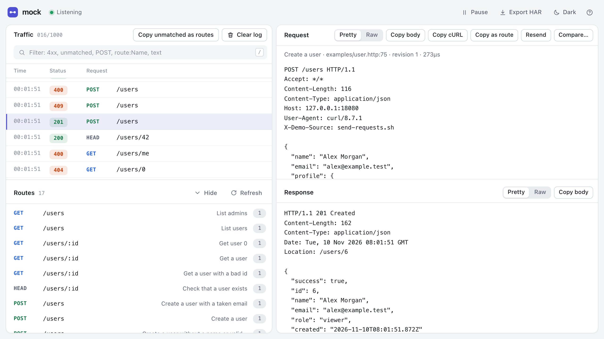

[Documentation](README.md) › Getting started

# Getting started

Start a new mock API from a commented starter file:

```sh
mock init          # writes api.http and users.json here
mock api.http
curl localhost:8080/users/7
```

`api.http` has four routes showing a path parameter, generated values, a
variable, a `< file` body, a `@json` matcher and route order. Its comments
explain each part. `mock init dir` writes into `dir` (creating it), and
`mock init` refuses to overwrite either file unless you pass `-force`.

Or run the example API from a checkout:

```sh
go run . examples/user.http
```

The server prints a short banner with the listen address, the admin UI URL, and
whether it is watching files, then the route list. It serves the mock API on
`127.0.0.1:8080` and the admin UI on `127.0.0.1:8081` by default:

```text
starting mock HTTP server on 127.0.0.1:8080
admin UI at http://127.0.0.1:8081/
watching request files for changes
Available mock methods:
  GET     /users                         List admins
  GET     /users                         List users
  GET     /users/:id                     Get user 0
  GET     /users/:id                     Get a user
  ...
```

While it is running, it watches the given `.http` file(s) and any `< path`
response bodies they reference. Save a file and the server reloads the routes
and reprints the updated method list. A failed reload keeps the previous routes
and logs the error.

```sh
curl http://localhost:8080/users/42
curl 'http://localhost:8080/users?role=admin'
curl -X POST -d '{"name":"Ann","email":"ann@example.test"}' http://localhost:8080/users  # 201
curl -X POST -d '{"name":"Ann"}' http://localhost:8080/users                            # 400
curl -X PATCH -d '{"role":"editor"}' http://localhost:8080/users/42
```

`examples/user.http` is a small users API: list, filter by role, get, create,
replace, update, delete, and a password reset. `examples/static.http` serves
HTML and text pages, from external files and inline.

Open the request console at [http://localhost:8081/](http://localhost:8081/).
The responsive UI shows each request and response with raw HTTP-style details,
a collapsible live-routes panel, filter/pause/clear controls, HAR export, light
and dark themes, and a Help dialog that explains those controls.

To populate the console during UI development, start the server with
`examples/user.http`, then run this Bash/curl script in another terminal:

```sh
./examples/send-requests.sh          # MOCK_PORT, or 8080 if unset
./examples/send-requests.sh -p 9000  # overrides MOCK_PORT
```

It sends 16 requests that walk through the users API: listing and filtering,
fetching, creating (`201`, `409` and `400` chosen by body matching), replacing,
updating, a password reset, and a `204` deletion.
It prints status/timing summaries and leaves response bodies for inspection in
the console. Rerun it whenever you need more traffic.

To see request matching in action, serve the files in `examples/matching/`.
Each one shows one area: `headers.http`, `json.http`, `forms.http`,
`paths-and-queries.http` and `webhooks.http` (raw bodies plus combined
matchers). Then run their request script, which prints the status and body
each scenario gets:

```sh
mock examples/matching/*.http
./examples/matching/requests.sh      # -p PORT or MOCK_PORT, like send-requests.sh
```

<picture>
  <source media="(prefers-color-scheme: dark)" srcset="web-dark.png">
  
</picture>

*The admin UI populated with `examples/send-requests.sh`, showing a successful POST request and its response. It follows the system light or dark theme; the toolbar switches it.*

You can also pipe a request file through stdin:

```sh
cat examples/user.http | go run .
```
